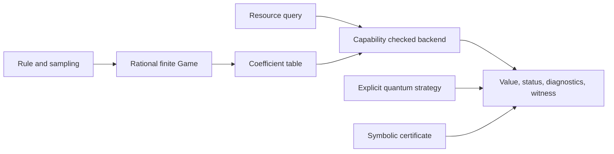

# Architecture and technology choices

NonLocaLang separates the verifier, resource assumptions, and the requested evidence.
The first executable dialect covers finite, one-round, classical interfaces. It is
an embedded Python construction language that compiles to immutable rational tables.
A callable rule is construction-time code; serialized games contain data only.

## Representation and cost

`Scenario(input_sizes, output_sizes)` specifies party-local alphabets, one output
alphabet per party. A singleton input alphabet represents no input. `Game` adds a
normalized joint input distribution and a rational score for every input/output
profile. Promises are zero input probabilities. Signed scores represent general
Bell functionals; only rewards in [0,1] represent acceptance probabilities.
`ResourceSpec` belongs to `AnalysisTask`, not to the game. A reference realization
is a separate `QuantumStrategy` and is never an implicit restriction on competitors.

Tables use lexicographic Cartesian-product order, inputs first, outputs second.
Compilation costs O(product_i |X_i||A_i|) entries, each an arbitrary-precision
rational. Rule compilation and parallel product have allocation guards. Direct
`Game` construction accepts already-materialized tables. Scenario profile properties
materialize tuples; callers should inspect `entries` before requesting huge profiles.
Versioned JSON preserves fractions as strings. Separate verifier, resource/task,
strategy, behavior, and certificate schemas retain their respective assumptions;
numerical quantum arrays carry explicit encodings and tolerances.
Rational readers apply [bounded scalar decoding](scalar-wire.md) before expanding
numeric strings; trusted Python construction remains an explicit separate path.

The coefficient lowering C[x,a] = mu[x] V[x,a] preserves every linear score. Keeping
mu and V as well retains experimental sampling, event semantics, and promise data.
Input-dependent output alphabets require padding plus a proof that extra outputs do
not change the resource-restricted optimum; arbitrary finite output sizes are not
silently identified. Independent sources and dimension limits are explicit resource constraints. Causal
rounds, quantum questions, referee systems, and postselection denominators require
additional dialects. Flattening their visible probabilities alone loses constraints.

## Stack comparison

| Route | Strength | Cost / decision |
|---|---|---|
| Python dataclasses + Fraction | Readable research DSL; exact verifier data | Chosen front end; Python enumeration is not zero-cost |
| NumPy + SciPy + CVXPY + SymPy | Mature linear algebra, LP, SDP, exact algebra | Chosen analysis stack; floating solvers require evidence labels |
| toqito | Existing nonlocal-game and quantum-information methods | Candidate differential-testing adapter; do not duplicate its whole scope |
| ncpol2sdpa | General noncommutative polynomial SDP generation | Candidate higher-order backend; current implementation exposes only two small NPA levels |
| Julia / JuMP / QuantumOptics ecosystem | Strong optimization and multiple dispatch | Viable alternative; adds a second runtime without resolving current bottlenecks |
| Rust/C++ native kernels | Faster enumeration and word normalization | Profile first; keep rational semantics and witnesses across the boundary |
| MLIR / standalone parser | Multiple dialects and compiler passes | Defer until interfaces and semantic-preservation obligations stabilize |
| GPU DSL / kernels | Accelerated large matrix computations | Not a front-end requirement; solver and cone size dominate first |

[TileLang](https://arxiv.org/abs/2504.17577) separates tiled dataflow from scheduling.
[CuTe DSL](https://docs.nvidia.com/cutlass/4.5.2/media/docs/pythonDSL/cute_dsl_general/dsl_introduction.html)
uses a Python interface to hardware-level abstractions.
[DeepGEMM](https://github.com/deepseek-ai/DeepGEMM) concentrates on a small set of
specialized computation kernels. The useful analogy here is layered semantic
primitives and specialized lowerings. It does not imply that nonlocal-game
optimization becomes cheap or decidable.

Existing implementations provide comparison targets:
[toqito NPA documentation](https://vprusso.github.io/toqito/dev/generated/gallery/nonlocal_games/npa_hierarchy/)
and [ncpol2sdpa](https://ncpol2sdpa.readthedocs.io/en/latest/).
The small native NPA backend makes the relation algebra auditable and avoids making
a general-purpose polynomial compiler a prerequisite. Higher levels should use an
adapter or a separately validated generator rather than extending ad hoc formulas.

## Transform contracts

- [Checked local and party relabelling](equivalence.md) preserves values when the
  resource contract follows the same party renaming. Output permutations may
  depend on the local input; inverse/composition and witness transport are explicit.
- Hidden mixture compiles the weighted score coefficients, using the posterior
  average reward at each input. It does not reveal a component tag. Its optimum is
  at most the weighted sum of component optima, generally not equal.
- Positive affine score changes preserve maximizers and map values by the same
  affine function. Negative scales turn maximization into minimization.
- Parallel product bundles questions and answers locally and multiplies rewards.
  Strategies may act jointly across instances. Even CHSH has classical two-copy
  value 10/16, strictly greater than (3/4)^2; the test suite checks this.

No hidden resource coercion is allowed. Generic quantum `AnalysisTask.solve()` is
unsupported. Users explicitly request NPA outer relaxations, an XOR-specific SDP,
or finite-dimensional strategy evidence. Dimension-constrained searches, fixed-state/PPT restrictions, and source networks
are selected through ResourceSpec; they cannot be inferred from a generic Bell functional.

## Next implementation gates

1. Add independent cross-checks against toqito/ncpol2sdpa on randomized small games.
2. Extend the verified rational LP and symbolic CHSH certificate paths to SDP
   dual certificates. Numerical bounds need independent rigorous verification.
3. Add sparse/factorized rule IR, symmetry actions, and reduction proof records;
   benchmark build time separately from solve time and certificate verification.
4. Extend the implemented source-incidence witnesses, exact compatibility
   fragments, and classical spiral inflation with higher-order/quantum inflation
   and causal protocols. Shared global randomness must
   not erase source independence.
5. Add target equivalence, extraction channels, and robustness certificates before
   exposing a self-testing claim API. Optimizer uniqueness is insufficient.
